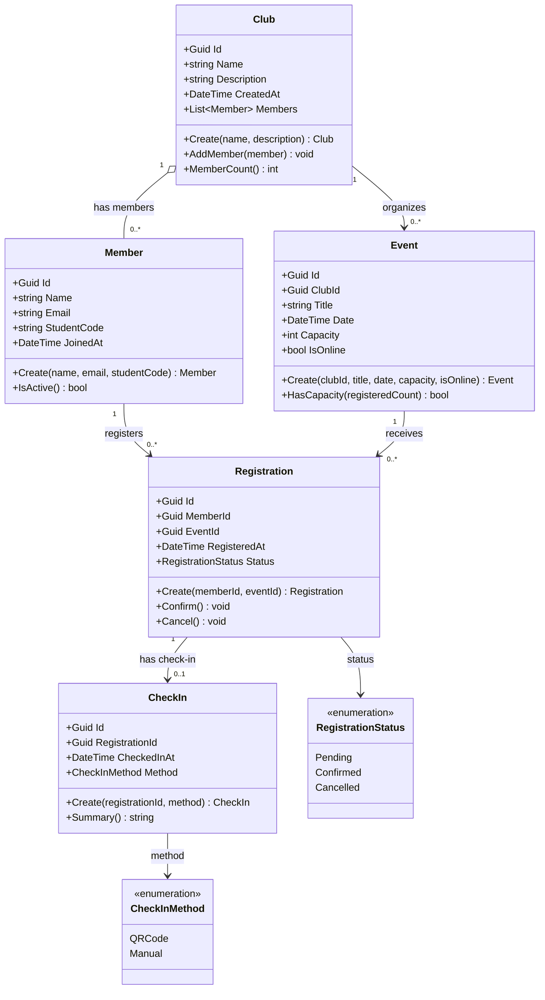

# EduHub — Class Diagram

## 1. Domain Classes

## 2. Relationship Multiplicities

- Một câu lạc bộ có thể có nhiều thành viên; một thành viên có thể tham gia nhiều câu lạc bộ. Trong mô hình này, quan hệ thành viên được thể hiện qua `Club.Members`.
- Một câu lạc bộ có thể tổ chức nhiều sự kiện; mỗi sự kiện thuộc một câu lạc bộ.
- Một thành viên có thể có nhiều phiếu đăng ký; mỗi phiếu đăng ký thuộc một thành viên.
- Một sự kiện có thể có nhiều phiếu đăng ký; mỗi phiếu đăng ký thuộc một sự kiện.
- Một phiếu đăng ký có tối đa một bản ghi check-in; một bản ghi check-in thuộc một phiếu đăng ký.